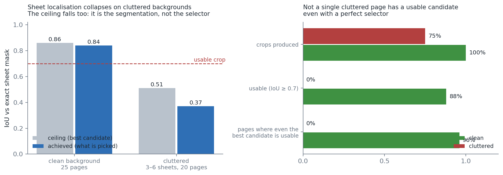
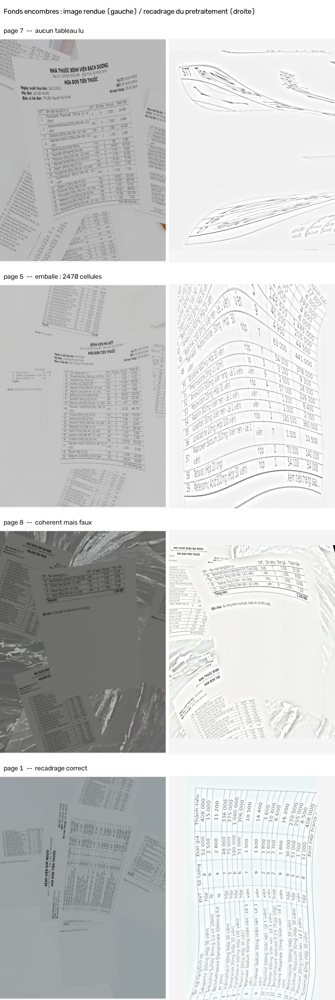
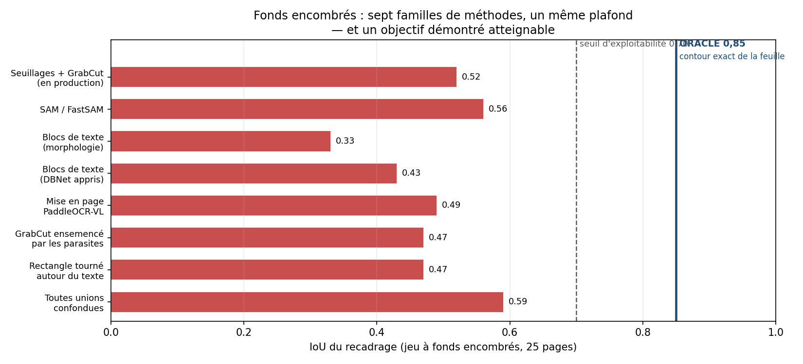
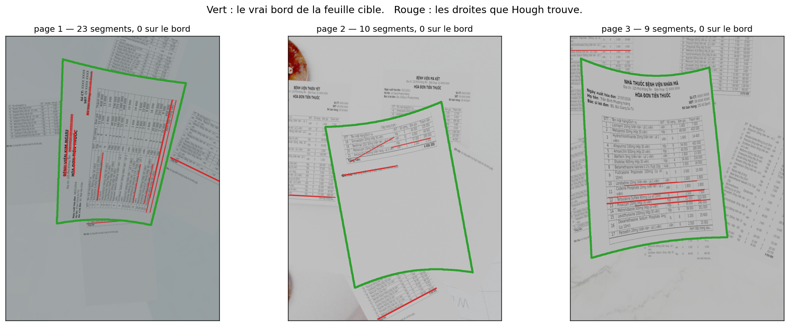
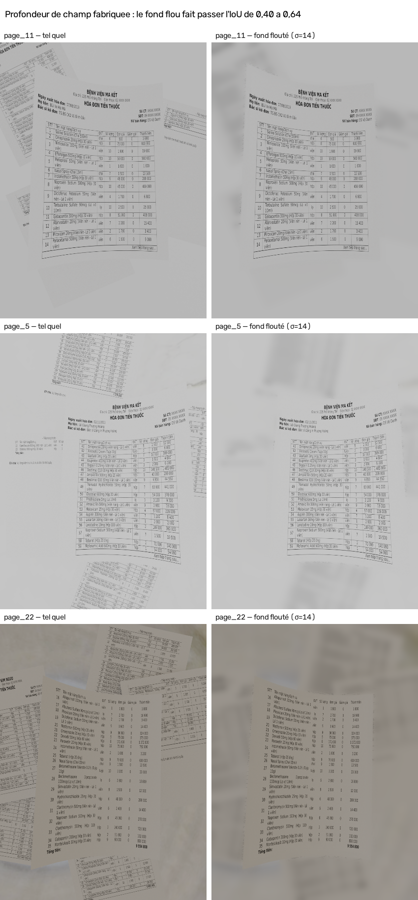
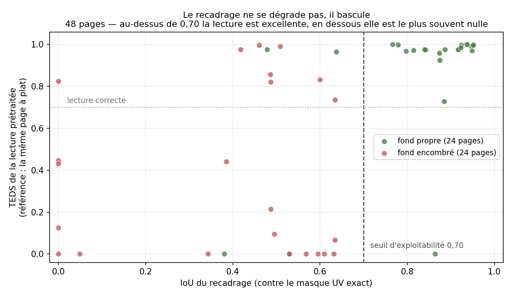

# Fonds encombrés : ce que quinze jours de mesures ont établi

**Question posée en réunion le 6 août.** Que devient la chaîne d'extraction
quand la photo ne montre pas une facture seule sur un bureau nu, mais une
facture posée au milieu d'autres documents — la situation normale dans un
service hospitalier ?

**Réponse courte.** La lecture tient, le recadrage s'effondre, et l'échec est
silencieux. Onze familles de méthodes ont été essayées pour réparer le
recadrage ; aucune n'y parvient, et on sait maintenant pourquoi, mesure à
l'appui : **le bord de la feuille cible est invisible**. Blanc sur blanc, sans
profondeur de champ, il ne porte aucun signal — sur 12 421 segments de droite
détectés, 3 tombent dessus.

Trois conséquences. Le recadrage **n'est pas nécessaire** : un lecteur qui
segmente les feuilles en interne obtient 0,677 de TEDS sans recadrer du tout,
contre 0,313 avec un recadrage faux. Notre plafond de 0,59 est **pessimiste** :
les méthodes publiées opèrent sur des photos, où le flou d'arrière-plan crée
le contraste que nos rendus n'ont pas. Et si l'on tient à recadrer, la bonne
réponse n'est pas de mieux chercher le bord mais de **ne plus le chercher** :
un rectangle grossier autour du tableau détecté donne 0,578 d'IoU et
12 pages exploitables sur 25, contre 1 aujourd'hui.

---

## 1. Le jeu de test

25 pages, les mêmes 12 factures que le jeu diversifié, rendues sous Blender
avec **3 à 6 feuilles parasites** disposées autour de la cible. Les parasites
portent du vrai texte et de vrais tableaux — ce sont d'autres pages du même
corpus — parce qu'un rectangle blanc uni ne pose aucune difficulté à un
détecteur.



### La vérité terrain est vérifiée, pas supposée

doc3D écrit une carte UV à côté de chaque rendu : le masque de la feuille
cible, au pixel près. Encore faut-il que les parasites n'aient pas fui dans
cette passe. `scripts/verifier_masque_uv.py` le contrôle en comptant les
composantes connexes — la feuille cible est un objet unique, donc son masque
est d'un seul tenant. **20/20 masques d'un seul tenant.** Un IoU bas sur ce
jeu est donc un vrai résultat, pas un artefact.

Ce contrôle a d'ailleurs remplacé une première version fausse, qui comparait
les aires entre jeu propre et jeu encombré : les écarts allaient de −41 % à
+49 %, dans les deux sens, ce qu'une fuite ne peut pas produire. La cause
était ailleurs — le renderer tirait ses caméras sans initialiser `random`, et
deux lancements donnaient des vues différentes.

---

## 2. Ce que la chaîne devient

### Chandra OCR 2 — 25 pages, deux branches

| | brut | prétraité |
|---|---|---|
| TEDS (avec fusion) | **0,604** | 0,313 |
| TEDS-Struct | 0,714 | 0,410 |
| champs d'en-tête | **62 %** | **15 %** |

Le prétraitement, qui apporte +0,050 sur fond propre, **coûte 0,29** ici. Il
ne dégrade pas la lecture : il la fait porter sur autre chose.

### Le cas dangereux, et il s'est produit

Facture 4, lecture prétraitée : **11 lignes sur 11 arithmétiquement
équilibrées, aucun trou de numérotation, confiance 0,75** — et 2 médicaments
sur 21 en commun avec la vérité terrain. TEDS 0,000.

C'est le cœur du problème, et il est plus grave qu'une baisse de score : la
validation arithmétique note la *cohérence* d'un tableau, jamais sa
*provenance*. Une facture voisine bien recadrée boucle exactement aussi bien
que la bonne. **La chaîne produit un résultat faux qu'aucun de ses contrôles
ne signale.**

### La réponse, et elle était gratuite

La lecture **brute** voit la scène entière : la facture cible est forcément
dans son champ, elle ne peut pas se tromper de document. Si le contenu du
recadrage ne recoupe pas celui de la lecture brute, c'est le recadrage qui est
parti ailleurs.

`adaptive.concordance()` compare les noms de médicaments des deux lectures —
les noms et non les nombres, parce que deux factures d'une même pharmacie
partagent des prix ronds mais jamais leurs listes de produits. Sous 30 % de
recouvrement, la lecture prétraitée est écartée.

| | effet |
|---|---|
| facture 4 | 0,000 → **0,762** |
| factures 3 et 12 | +0,306 et +0,163 |
| facture 7 (prétraitée réellement meilleure) | conservée à raison |
| jeux propres | **inchangés** — 0,967 et 0,977, tous deux au plafond |

Le départage de la politique adaptative est passé de « prétraité » à
« brut » : jamais moins bon sur les jeux propres, +0,103 ici. Une lecture
brute peut lire *mal*, elle ne peut pas lire *ailleurs*.

---

## 3. Le recadrage : onze tentatives



Chaque méthode a été mesurée par son **plafond** — le meilleur IoU atteignable
parmi les candidats qu'elle propose. C'est la bonne grandeur : un plafond bas
signifie qu'aucun sélecteur, si bon soit-il, ne peut réussir.



| famille | plafond IoU |
|---|---|
| seuillages + GrabCut *(en production)* | 0,52 |
| SAM / FastSAM | 0,46 – 0,56 |
| blocs de texte, morphologie | 0,33 |
| blocs de texte, DBNet appris | 0,43 |
| boîtes de mise en page PaddleOCR-VL | 0,49 |
| GrabCut ensemencé par les parasites | 0,47 |
| rectangle tourné autour du texte | 0,47 |
| coins par segments de droite + association | 0,00 |
| **toutes unions confondues** | **0,59** |
| **boîte de tableau ×1,2, sans détection** | **0,58** |
| *témoin ORACLE* | *0,85* |

### Le témoin qui manquait

Contrôle qui aurait dû venir en premier : **0,70 est-il seulement
atteignable ?** Tous les générateurs rendent un rectangle tourné, or une
feuille gondolée n'en est pas un.

`--oracle` donne au scoring le contour **exact** de la feuille. Il triche par
construction ; il mesure le plafond de la *représentation*, sans détection.

| jeu | plafond ORACLE | notre plafond | écart |
|---|---|---|---|
| propre | 0,86 | **0,86** | **0,00** |
| encombré | 0,85 | 0,52 | **0,33** |

Deux enseignements. Sur fond propre notre générateur est **exactement au
plafond** — aucune méthode ne peut faire mieux avec un rectangle. Et sur fond
encombré, les 0,33 d'écart sont une pure perte de détection : ni la forme du
candidat, ni la métrique, ni le jeu de test.

### Pourquoi elles échouent toutes

Deux échecs sont particulièrement instructifs.

**GrabCut ensemencé** était la meilleure idée : pour la première fois on
disposait de marqueurs de *fond* explicites, les boîtes des feuilles
parasites. Il échoue parce que GrabCut modélise des **couleurs**, et que la
cible et les parasites ont la même. Lui dire « ce blanc est du fond » lui
apprend que le blanc est du fond, et il mange la cible.

**Les coins par segments de droite** — l'analogue non appris de la méthode
publiée — ne produit aucun candidat. Instrumenté étage par étage, on voit que
l'**association** — le cœur de la méthode publiée, la partie qui répond à
« laquelle des feuilles » — n'est jamais atteinte : 21 pages sur 25 meurent
faute de segments, 4 de plus juste après.

---

## 4. Le bord est droit, mais invisible

Onze tentatives, un plafond à 0,59. Avant d'en écrire une douzième, la
question qu'aucune ne posait : **l'information cherchée existe-t-elle dans
l'image ?** On possède le masque UV au pixel près — on sait donc *où* est le
bord, et on peut aller mesurer ce qu'on y trouve.



La figure suffit presque : tout le rouge est sur les lignes de tableau et le
texte, jamais sur le vert.

### Le contraste

On mesure ce qu'un détecteur subit vraiment — le seuil retenant la moitié des
pixels du vrai bord, puis la part des pixels retenus qui lui appartiennent :

| | valeur |
|---|---|
| précision à recall 50 % | **2,2 %** |
| au hasard | 1,5 % |
| gain | **×1,50** |

Pour un point d'arête utile, un détecteur en encaisse **46 d'inutiles**.

### La mesure qui tranche

Parmi les segments que Hough rend effectivement, combien tombent sur le vrai
contour ?

| `minLineLength` | segments | sur le bord |
|---|---|---|
| 0,35 × diag | 428 | 0 |
| 0,20 × diag | 2 140 | 1 |
| 0,10 × diag | 9 853 | 2 |
| **total** | **12 421** | **3 (0,02 %)** |

### Une correction : la courbure n'y est pour rien

J'avais attribué l'échec de Hough au fait que « nos feuilles ne sont pas des
quadrilatères », écart 7,6 % de la diagonale. Ce chiffre était exact, mais il
mesurait l'écart au quadrilatère **englobant**, qui doit toucher les extrêmes
et gonfle mécaniquement dès que la feuille gondole. Contre le quadrilatère
**ajusté** : 4,17 %. Et mesurée directement, la plus longue portion droite à
2 px près fait **100 % du grand côté**.

Les bords sont droits. L'ancien chiffre était bon ; son interprétation ne
l'était pas.

La géométrie s'explique : la feuille est enroulée **cylindriquement**, donc
les deux bords parallèles à l'axe restent rectilignes et les deux autres
s'arquent — d'où le déséquilibre systématique des familles d'orientation dans
le diagnostic.

**Conclusion.** Le bord est droit mais **invisible** : blanc sur blanc, sans
profondeur de champ ni ombre portée pour le détacher. Aucune méthode fondée
sur les arêtes ne peut le localiser, quel que soit son réglage, parce que le
signal n'est pas dans l'image.

---

## 5. Trois hypothèses, mesurées

### La courbure : écartée

Corrélation courbure / IoU : **r = +0,04**. (Le §4 l'écarte par un second
chemin, indépendant : les bords sont droits.) Les pages peu courbées scorent
0,40, les très courbées 0,40. Et les deux jeux ont la **même** courbure —
médiane 7,3 % contre 6,6 % — pour un IoU de 0,40 contre 0,84. La déformation
n'explique rien.

### La profondeur de champ : facteur majeur

Nos rendus n'en ont pas : les parasites sont aussi nets que la cible. Sur une
vraie photo prise de près, ils seraient flous. On peut le fabriquer, puisqu'on
possède le masque exact de la cible.



| fond des images | IoU | pages exploitables |
|---|---|---|
| tel quel | 0,40 | **0/25** |
| flou σ = 6 px | 0,59 | 5/25 |
| flou σ = 14 px | **0,64** | **8/25** |
| *jeu propre, sans parasites* | *0,84* | *22/25* |

**La moitié de l'effondrement vient de l'absence de profondeur de champ.**
Notre jeu de test exagère donc la difficulté d'un facteur deux. C'est à dire
avant de conclure, et c'est la critique qu'on nous ferait sinon.

### L'encombrement lui-même : réel, moitié moindre qu'annoncé

Il reste 0,20 d'écart après compensation du flou. L'encombrement dégrade
réellement le recadrage — simplement pas dans les proportions que notre
benchmark suggérait.

---

## 6. Le seuil de 0,70, validé

`SEUIL_EXPLOITABLE = 0.70` traverse tous les scripts et la phrase « 0 page sur
25 exploitables » en dépend. Ce nombre venait d'un raisonnement, pas d'une
mesure. On l'a confronté à ce qui compte : la lecture.

Pour 48 pages, l'IoU du recadrage d'un côté ; de l'autre le TEDS de la lecture
prétraitée **contre la lecture de la même page à plat** — qui vaut 0,981
contre la vérité terrain, et fait donc office de vérité de page.



Corrélation **r = +0,53**, et surtout : la relation est **presque binaire**.
Au-dessus de 0,70 le TEDS vaut 0,91 à 0,99 ; en dessous, la médiane est nulle
dans trois tranches sur quatre. Ce n'est pas une dégradation progressive —
soit le recadrage tient la bonne feuille, soit il part ailleurs et il ne reste
rien. C'est une troisième confirmation, par une voie indépendante, que
l'échec est « le mauvais document » et non « un peu de contenu coupé ».

| seuil | vrais positifs | faux positifs | faux négatifs |
|---|---|---|---|
| 0,40 | 29 | **10** | 1 |
| **0,70** | 20 | **1** | 10 |

Les deux seuils prédisent aussi bien (77 %). Ce qui les sépare est le type
d'erreur, et 0,70 ne laisse passer **qu'un seul** mauvais recadrage. C'est le
bon arbitrage : un faux positif est exactement le mode d'échec silencieux
qu'on traque, alors qu'un faux négatif se solde par une lecture brute à 0,604.

**Nuance à énoncer :** « 0 page sur 25 exploitables » signifie « aucune ne
franchit une barre volontairement exigeante », pas « aucune n'est lisible ».

---

## 7. Le classement des modèles s'inverse

PaddleOCR-VL, en lecture brute, sur les mêmes 25 pages :

| | Chandra OCR 2 | **PaddleOCR-VL** |
|---|---|---|
| TEDS | 0,604 | **0,677** |
| TEDS-Struct | 0,714 | **0,738** |
| champs d'en-tête | 62 % | **77 %** |

C'est le premier jeu où PaddleOCR-VL passe devant, et la raison est
structurelle : **son détecteur de mise en page rend 2,5 tableaux par page — un
par feuille**, chacun proprement structuré. Là où Chandra, à qui l'on donne la
scène entière, produit un tableau confus ou part en boucle (2 470 colonnes sur
la facture 3), PaddleOCR-VL livre une lecture *par feuille*.

**Le même détecteur échoue comme recadreur (0,49 d'IoU) et réussit comme
lecteur (0,677 de TEDS).** Ce ne sont pas deux mesures du même phénomène.
Isoler la feuille et lire la bonne facture sont deux problèmes distincts, et
le second ne dépend pas du premier.

*(Vérifié au passage : `use_doc_preprocessor: False` — PaddleOCR-VL ne dewarpe
pas par défaut, contrairement à `PaddleOCR()` qui active UVDoc. Nos runs
« brut » sont bien bruts.)*

---

## 8. Ce que dit la littérature

Le problème a un nom — **multi-document localization in unconstrained
environments** — et il est reconnu comme peu traité.

Deux travaux directement dessus : Pan & Zhu (Neurocomputing, 2021) et Tan et
al. (PRCV 2025), ce dernier avec code et **jeu de données de 24 738 images**
publics.

**Et les deux emploient une formulation qui n'est aucune des nôtres.** Ils ne
segmentent pas de région : ils **détectent les coins** et les **regroupent en
instances de document** par *associative embedding*, technique venue de
l'estimation de pose humaine bottom-up — où il faut justement attribuer des
articulations à des personnes différentes dans une foule.

C'est exactement la reformulation à laquelle nos mesures avaient abouti : le
problème n'est pas de délimiter une feuille, il est de savoir **laquelle**.
Nos neuf tentatives sont toutes des variantes de « trouver la région du
document », alors que la bonne question est « à quel document appartient ce
coin ». Le résultat négatif est donc conforme à l'état de l'art, pas un aveu
d'inexpérience.

---

## 9. Recadrer sur le contenu, pas sur la feuille

Si le bord est invisible mais que le contenu ne l'est pas, la question « où
est la feuille ? » est peut-être mal posée. Test : prendre la plus grande
boîte de tableau de PaddleOCR-VL et la dilater, sans aucune détection de
contour.

| variante | IoU | exploitables |
|---|---|---|
| production (aucun traitement) | 0,35 | 1/25 |
| flou du fond puis détection, ×1,6 | 0,55 | 4/25 |
| **boîte de tableau ×1,2, sans rien d'autre** | **0,578** | **12/25** |

Un rectangle grossier autour du bon tableau bat les onze générateurs qu'on
avait construits (0,52 au mieux) et atteint à lui seul le plafond de leur
union. **12 pages sur 25 passent le seuil, contre 1.**

Trois contrôles, parce que ce genre de résultat se révèle souvent creux.

**Le facteur n'est pas surajusté.** Validation croisée à deux plis sur 200
partitions : 0,576 contre 0,578 pour le meilleur facteur choisi sur le jeu
entier. Entre 1,1 et 1,3 le réglage n'a presque pas d'importance.

**Le flou, lui, n'apporte presque rien.** En comparant le quadrilatère détecté
après floutage à la boîte dilatée seule, l'écart est de −0,02 à ×1,2 : le
détecteur suit simplement la frontière du flou. Il ne remonte à +0,04 qu'à
×1,4. L'idée de fabriquer une profondeur de champ menait quelque part, mais
pas par le mécanisme prévu.

**Le choix du tableau n'est pas le goulot.** « Le plus grand » prend le bon
23 fois sur 25 — mieux qu'une sélection oracle.

Réserve : 0,578 reste loin de l'ORACLE à 0,85, la boîte étant alignée sur les
axes quand les feuilles sont tournées. Et le gain porte sur le recadrage, dont
la §2 a montré qu'il n'est pas le chemin critique. Reste à le mesurer en TEDS
de bout en bout.

---

## 10. Recommandations

**Refuser de recadrer quand la scène est encombrée.** Deux heures de travail,
et ça vaut +0,29 de TEDS immédiatement (0,604 brut contre 0,313 prétraité).
C'est la seule action dont le rapport valeur/effort soit évident.

**Ne plus prendre bêtement le plus grand tableau.** Avec 2,5 tableaux par page
chez PaddleOCR-VL, `max(tables, key=len(rows))` est un défaut, pas une
décision. Trois signaux sont disponibles et aucun n'est utilisé : la
centralité de la boîte de mise en page, la concordance entre pages
consécutives, la cohérence arithmétique. Le rappel de fusion à 31 % pour une
précision de 100 % dit qu'il y a de la marge.

**Arrêter de chercher un recadrage propre sur CE jeu de test.** Onze familles,
un plafond qui ne dépasse jamais 0,59 pour un atteignable à 0,85. Et la raison
n'est plus une conjecture : le bord ne porte pas de signal (§4). Une douzième
méthode échouerait pour la même raison — y compris une méthode apprise, qui ne
peut pas davantage apprendre d'une arête absente.

**La segmentation apprise devient un choix, pas une nécessité.** Elle
règlerait le recadrage, mais on vient de montrer que le recadrage n'est pas le
chemin critique. Si elle est retenue, elle part du jeu public de 24 738 images
plutôt que de zéro, et nos masques UV servent d'affinage.

### Deux mesures qui manquent

**Un jeu encombré avec profondeur de champ — c'est devenu la priorité.** Ce
n'est plus un raffinement de validité : le §4 montre que la profondeur de
champ ne *module* pas le signal de bord, **elle le crée**. Tant qu'on rend
sans ouverture simulée, on mesure un problème qu'on a fabriqué. Une ouverture
dans Blender, et les 25 mêmes pages, disent si le recadrage sur fond encombré
est difficile ou si notre benchmark l'était.

**Une validation sur photos réelles.** SmartDoc 2015 Challenge 1 contient un
fond « document posé sur une pile de papiers », avec vérité terrain
quadrilatère et les mêmes documents photographiés sur cinq fonds différents —
une expérience appariée idéale. `scripts/eval_smartdoc.py` est prêt ; il ne
manque que le téléchargement.

---

## Reproduire

```powershell
# Le jeu de test
.\render_variants.ps1 -FolderId variants_encombre -Parasites -1
python scripts\verifier_masque_uv.py --jeu variants_encombre

# Le recadrage et ses plafonds
python src\eval_preprocess.py --batch variants_encombre
python scripts\sonde_plafond.py --jeu variants_encombre --oracle
python scripts\sonde_plafond.py --jeu variants_encombre --dbnet --oracle
python scripts\sonde_plafond.py --jeu variants_encombre --layout variants_encombre_paddleocr

# La lecture
python scripts\eval_all.py --modele chandra --jeu variants_encombre
python scripts\eval_all.py --modele paddleocr --jeu variants_encombre

# La validation du seuil
python scripts\eval_seuil_iou.py

# Le bord est-il visible ? (contraste, droiture, segments sur le contour)
python scripts\mesure_arete.py --figure

# Recadrer sur le contenu
python scripts\recadrage_par_contenu.py --flou
```

Détail complet, y compris les impasses et les erreurs de méthode corrigées en
route : [`docs/fonds_encombres.md`](../docs/fonds_encombres.md).
