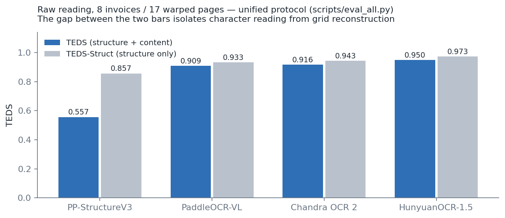
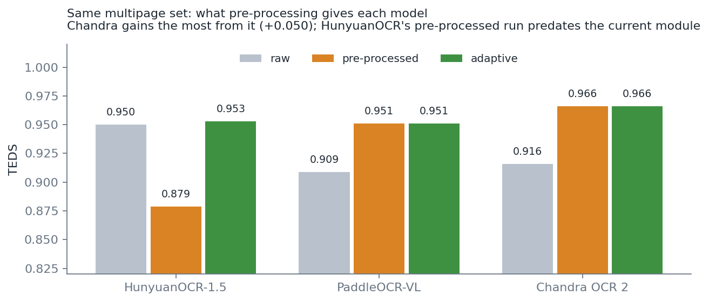
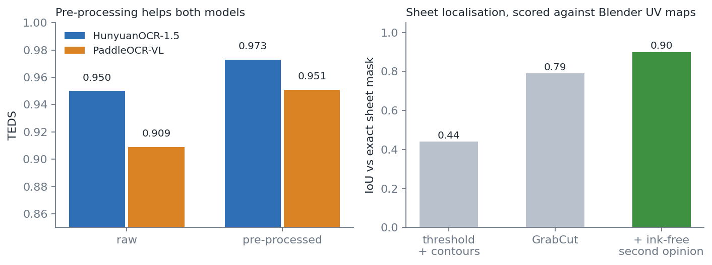
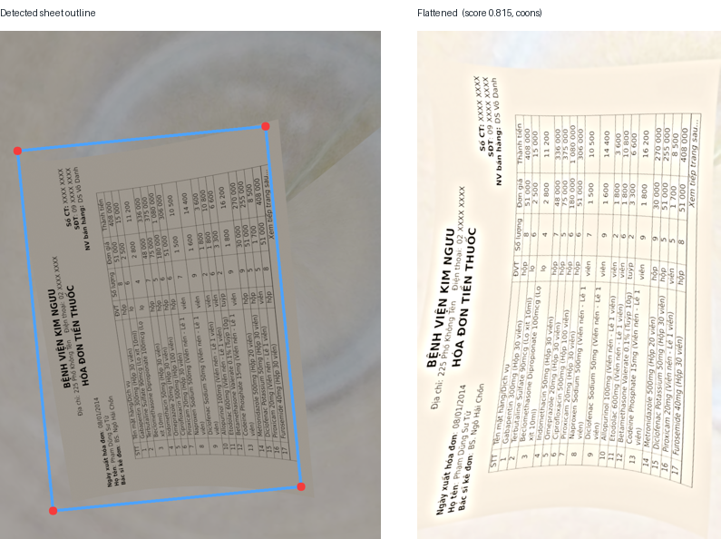
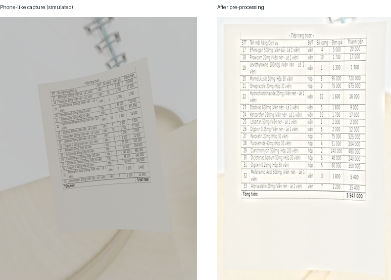
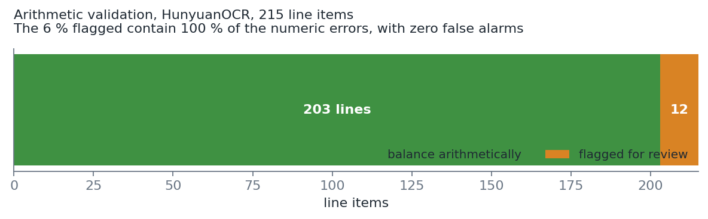
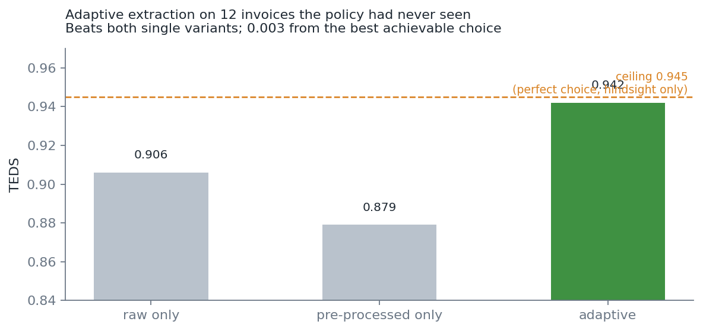
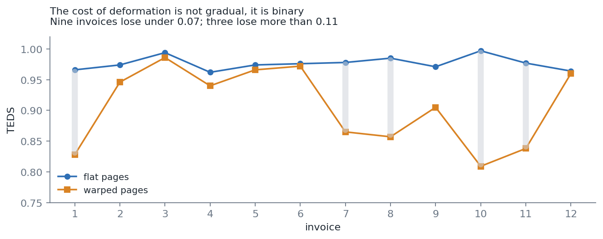

# Advanced Information Extraction from Smartphone-Captured Medical Documents

**Internship progress report — IMT / PTIT Hanoi**
Supervisor: Thanh-Ha DO · Report date: 5 August 2026 · Week 3 of 12

---

## Summary

The goal is a pipeline that turns a smartphone photo of a Vietnamese medical
invoice into structured, verified data. Three weeks in, the core is built and
measured, and the deliverables planned for weeks 1–8 are complete.

| | TEDS | header fields | multi-page merge |
|---|---|---|---|
| Chandra OCR 2, adaptive | **0.966** | 29/32 | 100 % / 100 % |
| HunyuanOCR-1.5, adaptive | 0.953 | 28/32 | 100 % / 100 % |
| PaddleOCR-VL, adaptive | 0.951 | 24/32 | 100 % / 100 % |
| PP-StructureV3 | 0.557 | 9/32 | 100 % / 100 % |

All four models are measured by one command — `scripts/eval_all.py` — with
the same ground truth, so the columns are strictly comparable. The
evaluation code itself has been improved since the first figures circulated
(Markdown table parsing, three ground-truth corrections); every number in
this report was re-measured under the current code.

Two contributions go beyond the original plan.

**Multi-page table merging.** Vietnamese pharmacy invoices routinely spill a
single medication table across two or three pages. Every model reads each page
in isolation, so the table comes back cut in pieces. The merging step
reassembles it at **100 % precision and 100 % recall**, with **zero wrong
merges** across eight benchmark runs.

**Adaptive extraction.** An invoice is arithmetically redundant — every line
satisfies `quantity × unit_price = total`, and the lines sum to the printed
grand total. That redundancy lets us **score an extraction without any ground
truth**, which is the situation in production. The pipeline reads each page
twice, scores both readings, and keeps the one that holds up. On twelve
invoices the policy had never seen, it beats both single readings and lands
**0.003 from the best achievable choice**.

A working prototype exists: a Progressive Web App that takes a photo, shows
every step of the chain, and returns JSON.

---

## 1. The problem, and the constraint that shapes everything

The subject targets **smartphone photographs**, explicitly excluding native
PDFs. That single constraint drives the whole design: the input is warped, its
lighting is uneven, its resolution varies, and the page boundary must be found
before anything else can happen.

A second constraint is legal. Real patient invoices cannot be collected, and
even if they could, they carry personal health data. Working on them at
internship scale is not an option.

### The consequence: build the ground truth rather than find it

No public dataset exists for photographed Vietnamese medical invoices with
exact ground truth. We generate one.

```
JSON (patient, doctor, medication list)
  → LaTeX with longtable, which splits long tables across pages by itself
  → PDF → PNG
  → Blender projects each page onto a curved 3-D mesh, with a real
    background and realistic lighting
```

This gives something no real photograph can: **the exact answer is known
before the photo exists**. Blender also writes a UV map next to every render,
whose first channel is a pixel-perfect mask of the sheet — so even the
page-localisation step can be scored exactly.

Two independent ground truths are maintained, and keeping them separate is a
methodological point rather than a detail:

- the **generator JSON** says what the invoice contains — it feeds table
  scoring, arithmetic validation, and field evaluation;
- the **source PDF** says where the invoice breaks across pages — it feeds the
  merge evaluation.

Deriving page grouping from OCR output would mean grading the merging
algorithm on the very data that inspired it.

---

## 2. Measuring: TEDS

We use **TEDS** (Tree-Edit-Distance-based Similarity, Zhong et al., PubTabNet
2020), the standard metric for table recognition. Using the published metric
rather than a home-grown score means these numbers are directly comparable to
the literature — and it removes any suspicion that the metric was chosen
because it flattered the result.

### How it works

An HTML table is a tree: `table → tr → td`, with the text in the leaves. TEDS
measures the **minimum number of edit operations** — insert, delete, rename a
node — needed to turn the predicted tree into the expected one, then
normalises:

```
TEDS = 1 − edit_distance / max(nodes_predicted, nodes_expected)
```

The detail that matters: **renaming a cell does not cost 1**, it costs the
normalised edit distance between the two strings. Reading `500mq` instead of
`500mg` is therefore nearly free, while losing the cell entirely is not.

Measured on a three-line reference table (`demo/explain_teds.py` reproduces
this in one second, no model required):

| error introduced | TEDS | TEDS-Struct | naive cell accuracy |
|---|---|---|---|
| perfect reading | 1.000 | 1.000 | 1.00 |
| one wrong character | 0.998 | 1.000 | 0.96 |
| one damaged diacritic | 0.989 | 1.000 | 0.96 |
| one empty cell | 0.967 | 1.000 | 0.96 |
| one column lost | 0.867 | 0.867 | **undefined** |
| one row missing | 0.767 | 0.767 | **undefined** |

Two properties are visible at once.

**It grades.** A wrong character, an empty cell and a lost row do not cost the
same, and they rank in the right order. A binary metric would price all three
identically.

**The second column isolates the kind of error.** TEDS-Struct stays at 1.000
as long as only text is wrong, and drops as soon as the grid breaks. That is
what let us say PP-StructureV3's bottleneck is character reading rather than
table detection — a 0.300 gap between the two columns.

### Why not simple cell accuracy

It becomes **undefined** the moment a row or a column is missing, because it
compares cells at matching positions and there are no longer matching
positions. That is precisely the most common OCR failure on a table. TEDS
stays defined in every case.

### What it says about multi-page tables

On the same reference table, reading the first page **perfectly** — while the
invoice continues on a second — scores **0.533**. Two thirds of the table are
simply absent. That is the ceiling for any system that reads pages in
isolation, and it is measurable without running a single model.

---

## 3. Model comparison

Four models were evaluated on the same 17 warped pages: HunyuanOCR-1.5 (1 B
parameters), PaddleOCR-VL (0.9 B), PP-StructureV3, and Chandra OCR 2 (5 B).
Chandra does not fit in the laptop's 4 GB of VRAM; its runs were produced on
a rented Kaggle T4 (`kaggle/bench_kaggle_chandra.ipynb`), in fp16 — the T4
has no hardware bf16 — at roughly 81 s per page.



Raw reading, one bar pair per model:

| model | size | TEDS | TEDS-Struct | gap | s/page |
|---|---|---|---|---|---|
| HunyuanOCR-1.5 | 1 B | **0.950** | 0.973 | 0.023 | ~87 (laptop GPU) |
| Chandra OCR 2 | 5 B | 0.916 | 0.943 | 0.027 | ~81 (Kaggle T4) |
| PaddleOCR-VL | 0.9 B | 0.909 | 0.933 | 0.024 | ~230 (CPU) |
| PP-StructureV3 | — | 0.557 | 0.857 | **0.300** | ~60 (CPU) |

The most instructive result is still **PP-StructureV3's 0.300 gap** between
TEDS and TEDS-Struct. It reconstructs the grid well but reads Vietnamese
characters poorly: the bottleneck is character recognition, not table
detection. That single observation ruled out an entire family of classical
pipelines for this language.

**On raw warped pages, five times more parameters do not buy first place.**
Chandra 2's public benchmarks predicted this: its Vietnamese score (80.4 %)
sits below its own 43-language average and *regressed* from Chandra 1 —
the version 2 gains went to other languages. We wrote that prediction down
before running the benchmark (`docs/chandra_ocr2.md`), and it held.



**With pre-processing, the ranking flips.** Chandra turns out to be the
model that benefits most from the flattened, illumination-corrected input:
0.916 → 0.966, against 0.950 → 0.879 for HunyuanOCR (whose pre-processed
run predates the current pre-processing code — a caveat that also means its
adaptive figure is a floor rather than a ceiling). Under the adaptive
policy, which needs no ground truth, Chandra ends at **0.966 with 29/32
header fields — the best multipage result of the four** — and at **0.977
(ceiling 0.977)** on the twelve deformed invoices of the diversified set,
where HunyuanOCR has not been run and PaddleOCR-VL reaches 0.942.

On the flat diversified set Chandra reads 47/48 header fields and reaches
0.981 of TEDS against 0.976 for PaddleOCR-VL.

Two Chandra-specific defects are worth naming, because the metrics alone
hide them. Its HTML tables occasionally carry a malformed header
(`colspan`/`rowspan` misplaced, one column absorbed) — visible on the very
first multipage page. And its arithmetic-validation recall is 80 % rather
than 100 %: one of its misreads shifted a whole line by one column in a way
that still multiplies correctly (1700 × 6800 = 11 560 000), the only kind
of numeric error the arithmetic check is structurally blind to. Neither
defect affects the merge decisions, which stay at 100 % precision and
recall across all five Chandra runs.

---

## 4. Multi-page table merging

This is the internship's main technical contribution, and it answers a
specific remark from the supervisor.

### Why it is hard

Every OCR model reads one page at a time. When a medication table spans pages,
the model returns two tables, each with its own header, and the page-break
artefacts in between: a repeated header row, a `-- Tiếp trang trước --`
continuation banner, a `Xem tiếp trang sau...` footer.

Recognising a continuation is not obvious, because two consecutive invoices
from the same pharmacy look almost identical: same column template, same
header text, same fonts.

### How the decision is made

The algorithm combines several signals rather than trusting one:

| signal | what it means |
|---|---|
| continuation marker on page B | the document says so explicitly |
| numbering continuity | page A ends at 19, page B starts at 20 |
| B starts above 1 | the numbering came from somewhere |
| A ends with a grand total | the invoice is closed |
| B restarts at 1 | a new numbering is a new document |
| compatible shape | same column count, or similar header |

Two of these act as **vetoes**: an invoice that ends on its grand total, or a
table that restarts at 1, closes the document. A continuation marker on the
next page overrides both — that is the document asserting the continuation
rather than us inferring it.

### Results

| run | precision | recall |
|---|---|---|
| HunyuanOCR-1.5 | 100 % | 100 % |
| HunyuanOCR-1.5, pre-processed | 100 % | 100 % |
| PaddleOCR-VL, pre-processed | 100 % | 100 % |
| PP-StructureV3 | 100 % | 100 % |
| diversified set, flat | 100 % | 100 % |
| diversified set, warped | 100 % | 100 % |

**Zero wrong merges across every run.** That is the number that matters most:
a missed continuation costs some TEDS, but a wrong merge fabricates a table
mixing two different patients' invoices — and nothing downstream can detect
it, because each line still balances arithmetically.

Merging is worth **+0.26 to +0.34 of TEDS** depending on the model. On the
diversified set, where five invoices carry no continuation marker at all, the
gain reaches **+0.34**: that figure quantifies what the algorithm recovers
when the document itself signals nothing.

---

## 5. Pre-processing — the Phase 1 deliverable

The module locates the sheet, flattens it, evens out the lighting, and
denoises. Unlike a dewarping oracle, **it knows nothing about the
deformation** — it estimates everything from the image alone, which is what a
real application must do.



Sheet localisation is scored exactly against the Blender UV masks. The naive
approach — thresholding plus contour detection, the literal reading of the
subject's Phase 1 — reaches **IoU 0.44 and produces zero usable crops**. It
latches onto the **table border** rather than the paper edge, because on a
printed invoice the highest-contrast rectangle is the table. A naive
pre-processing module would therefore have cropped away the header — hospital,
patient, date, doctor — while appearing to work.

GrabCut brings this to 0.79 by modelling colour *distributions* instead of
thresholding one cue. Measurements show why that matters: comparing the sheet
region against the background across our renders, brightness, saturation and
texture each **flip sign** from one image to the next.

A second opinion with the ink erased brings it to **0.90**, and the rule
behind it is checkable rather than tuned: erasing the ink cannot move the edge
of the sheet, so the two readings should agree. When the second is much
larger, the first was locked onto printed content.



### What pre-processing actually buys



On the original test set it lifts HunyuanOCR from 0.950 to **0.973** and
PaddleOCR-VL from 0.909 to **0.951**.

It also recovers information that was entirely lost. On one page, the raw OCR
output contains **no patient, date or doctor block at all** — not misread,
absent. On the pre-processed image, all three lines appear. That answers a
question left open for a week: the fields were being lost to the deformation.

But it is not free. On the warped diversified set, pre-processing taken alone
**degrades** the result — 0.906 → 0.879 — and header fields collapse from
42/48 to 24/48, because the crop clips the sheet edge on some pages and
PaddleOCR-VL's layout analysis discards a partially cut text line entirely.

The right way to read this: pre-processing is not a replacement for the raw
reading, it is a **safety net**. It rescues pages that drop out, at the cost
of new losses elsewhere. Which leads to the next section.

---

## 6. Arithmetic validation, without ground truth

An invoice checks itself. Every line satisfies `quantity × unit_price =
total`, and the lines sum to the printed `Tổng tiền`.



On 215 line items read by HunyuanOCR, **12 lines are flagged (6 %), and they
contain 100 % of the numeric errors, with zero false alarms**. That is what
makes a TEDS of 0.97 usable in practice: a human reviewer is shown six per
cent of the document, not all of it.

Two honest limits:

- **Name errors are invisible to arithmetic by construction.** Nothing in the
  invoice reveals that `Xetoprofen` should read `Ketoprofen`. Catching those
  would need a medication dictionary — a separate and complementary avenue.
- When two of the three numbers are right, the third can be **recomputed**.
  The pipeline does this and marks the line `corrected` rather than silently
  overwriting it.

---

## 7. Adaptive extraction

The validation score above needs no ground truth. That makes it usable for
something else: **ranking two candidate readings of the same photograph**.

The pipeline reads each page twice — raw and pre-processed — scores both, and
keeps the one that holds up. Table and header fields are decided
independently, because they fail independently.



The policy was designed and tuned on the original 8 invoices. Applied
unchanged to **12 invoices, 6 layouts, warped — data it had never seen** — it
beats both single variants on both metrics and lands 0.003 from the ceiling.

Why it wins is visible in the detail:

| invoice | confidence raw / pre-processed | kept | TEDS raw | TEDS pre-processed |
|---|---|---|---|---|
| 9 | 1.00 / 0.75 | raw | **0.905** | 0.509 |
| 12 | 1.00 / 0.75 | raw | **0.960** | 0.580 |
| 1 | 0.60 / 1.00 | pre-processed | 0.828 | **0.957** |

On two invoices pre-processing collapses, and **the ground-truth-free score
sees it**. On a third, pre-processing rescues a page that had dropped out, and
the score sees that too. This is the clearest validation of the principle: an
invoice's internal redundancy is enough to detect an extraction disaster where
no ground truth exists — which is exactly the production situation.

---

## 8. Does any of this generalise?

The original test set is 8 invoices from **one template**, where the `STT`
column restarts at 1 in every invoice. That is precisely the assumption the
most discriminating merge signal rests on. A test set that respects it
everywhere cannot put it in doubt.

So a second set was built: **12 invoices, 25 pages, 6 layouts**, varying
numbering mode, continuation marker, column count (5, 6 or 7), border style,
and presence of the total row. Five invoices number **continuously across
invoices** — the adversarial case, where the end of one invoice and the start
of the next look exactly like a page continuation.

It found real defects.

**Two in the algorithm.** With continuous numbering, invoice N ending at 32
and invoice N+1 starting at 33 were **merged into one** — the worst failure
available. And when OCR lost a page entirely, a rescue branch merged across an
invoice boundary. Both are fixed, both are covered by
`tests/test_merge_assumptions.py`, which runs in one second without any model.

**Three in the measurement itself.** The page-grouping reference keyed on the
continuation marker — one of the very signals the merge algorithm uses. The
expected-table builder hard-coded six columns and numbering from 1. These made
a 5-column invoice score 0.836 when it actually scored **0.974**.

The pattern is worth stating plainly, because it generalises beyond this
project: **each widening of the test set broke the measuring instrument before
it measured anything.** A benchmark built on a single template does not only
validate the algorithm too little — it validates its own reference too little,
and the agreement between the two proves nothing.

### The cost of deformation, isolated

The same 12 invoices exist flat and warped, same content, same layout. Only
the deformation changes.



Deformation costs **−0.070 of TEDS** (0.976 → 0.906) but only **−0.020 of
structure** (0.986 → 0.966). It damages *character reading* far more than grid
reconstruction — consistent with what PP-StructureV3 showed earlier.

And the effect is **binary, not gradual**: nine invoices lose under 0.07, three
lose more than 0.11. Either the page survives or it drops out. That is a
measured argument for pre-processing: its job is not to shave hundredths off
easy pages, it is to bring dropped pages back into the regime where the model
works.

---

## 9. The application

A Progressive Web App, backed by a FastAPI service. Photo in, verified table
and JSON out.

The interface deliberately exposes every step, because a demonstration should
show reasoning and not just a result:

| step | what is shown |
|---|---|
| reception | the pages submitted |
| pre-processing | the detected quadrilateral drawn on the photo, its score, the flattened image |
| reading | progress, page by page |
| merging | for each transition, merged or separate, **and the signals that decided it** |
| validation | each line coloured by status: ok, corrected, inconsistent, incomplete |
| adaptive choice | the confidence of each reading, and which was kept |

Two design decisions worth naming:

**Compute stays server-side.** The models are gigabytes; the phone
photographs, the server reads. This also allows changing model without
redeploying anything to devices.

**The second reading is conditional.** Paying for two readings on every photo
doubles the wait, and it is often useless — on the diversified set, the raw
reading already scored 1.00 on five invoices out of twelve. The API reads the
raw image, scores it, and only pays for the second reading when that score
doubts. It is the adaptive idea applied to compute time rather than accuracy.

A **replay mode** re-runs an already computed result instantly, which is what
should be used in a meeting: nobody watches a frozen screen for three minutes.

---

## 10. Eight silent failures

Not one of the following raised an error. Every one was found by comparing
against a reference, and this is the most concrete argument in favour of the
whole evaluation apparatus.

| failure | effect | how it was found |
|---|---|---|
| torchvision image backend | HunyuanOCR emitted 6842 characters of gibberish in 315 s | output inspection |
| English prompt (official, verbatim) | triggered layout analysis instead of parsing — perfectly well-formed output, answering another question | comparing output shapes |
| Vietnamese `đ` | NFKD does not decompose it, so `ĐVT` never matched `dvt` and **the unit column was lost from every parsed invoice** | field-level evaluation |
| mirrored columns | one page returned right-to-left with no header; the export produced a plausible empty invoice | explicit extraction status |
| Markdown tables | HunyuanOCR sometimes answers in Markdown, not HTML; the parser discarded the whole page, content intact | page-level audit |
| footer prose | `bác sĩ` appears as an ordinary word in the legal footer, filling the doctor field with a sentence | reading extracted values |
| non-deterministic GrabCut | five identical calls returned areas 0.504, 0.413, 0.021, 0.021, 0.021 — the module was not reproducible | repeat measurement |
| NumPy 2.x | PaddleOCR replaced the real `ImportError` with "a dependency error occurred during pipeline creation", naming neither package nor exception | full traceback |

The thread connecting them: **nothing crashes, everything appears to work.**
Only confrontation with a reference reveals the problem. This deserves a
section of the final report in its own right.

---

## 11. Limitations

Stated plainly, because they will be the first questions asked.

**All data is synthetic.** 20 invoices, 7 layouts, 42 pages — one generator,
one deformation engine. No real photograph has been processed. The planned
remedy is to **print the fake invoices and photograph them**, which keeps the
exact ground truth that no real document allows. It is blocked on printer
access, not on method.

**Sample size.** The adaptive policy holding on a set it had never seen is a
genuine indication of generalisation, but twelve invoices is twelve invoices.

**A TEDS of 0.97 still leaves roughly 3 % of cells wrong.** On medical
invoices, this is not shippable without human review. The arithmetic
validation makes that review cheap — six per cent of lines — but it does not
remove it.

**The application is a prototype.** It has no authentication and no
encryption, and it carries patient names. It must not leave a local
demonstration network. Photo grouping, page ordering, capture-time quality
control and manual correction are all missing.

---

## 12. Licensing and ethics

**HunyuanOCR** is released under the Tencent Hunyuan Community License, whose
Territory **excludes the European Union, the United Kingdom and South Korea**.
Development and deployment in Vietnam are compliant. Two restrictions apply
everywhere: outputs may not be used to train another model, and the acceptable
use policy restricts automated decisions in medicine.

This has a practical consequence already encountered: compute platforms whose
region cannot be chosen — Kaggle and Colab among them — are a licensing risk.

**PaddleOCR-VL** is Apache 2.0 with none of these constraints. That is a
selection criterion that does not reduce to accuracy, and it deserves an
explicit decision rather than a default.

**Chandra OCR 2** sits in between: Apache 2.0 code, weights under a modified
OpenRAIL-M — free for research and for organisations under $2 M of
funding/revenue, no geographic restriction. Unlike HunyuanOCR it can be run
on region-less platforms such as Kaggle without licensing risk, which is
exactly how its benchmarks here were produced. Given that it also posts the
best adaptive score, the model choice is now a genuine three-way trade-off
between accuracy, hardware cost (5 B does not fit the laptop GPU) and
licence.

---

## 13. Status against the schedule

| weeks | planned | status |
|---|---|---|
| 1–2 | Literature review, tooling | **done** |
| 3–4 | Image enhancement pipeline | **done and validated** |
| 5–6 | OCR integration, text alignment | **done** |
| 7–8 | Layout analysis / NER | **partial** — labelled field extraction done; free-text NER not started |
| 9–10 | Testing on various mobile qualities | **partial** — 42 warped pages, no real photographs, no quality degradation study |
| 11–12 | UI/API prototype, documentation | **prototype done**, documentation in progress |

Currently in week 3, with weeks 1–6 complete and 7–10 half complete.

### Next steps, in order of value

1. **Image degradation study** — motion blur, sensor noise, JPEG compression,
   under-exposure. Pure software, produces the week 9–10 deliverable, and
   tests a hypothesis nothing else can: does pre-processing pay off *more* as
   quality drops?
2. **Real photographs** — print and shoot. The most predictable criticism of
   the whole work.
3. **Anonymisation (Phase 4)** — not started; connects directly to the ethics
   discussion above.
4. **Free-text NER** — the current corpus is almost entirely tabular; the
   generator needs enriching first for the task to mean anything.

---

## Appendix — what is in this folder

| file | what it is |
|---|---|
| `REPORT.md` | this document |
| `README.md` | how to run the live demonstration |
| `figures/` | every figure, generated from measured values |
| `artifacts/sample-invoice.json` | a real export, straight from the pipeline |
| `artifacts/merge-decisions.txt` | the merge evaluation, decision by decision |
