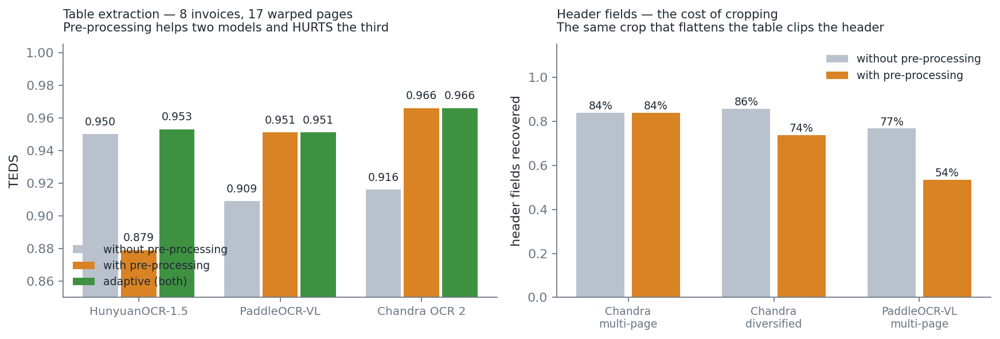

# With or without pre-processing — what the measurements say

Asked for by the supervisor in the 6 August meeting: *try it without
pre-processing, for comparison*.

The answer already existed. Each model was measured on the **same pages**,
read twice: raw image and pre-processed image. This document gathers the
figures, and above all what they imply.

To reproduce:

```powershell
python scripts\eval_all.py --modele chandra --modele hunyuan --modele paddleocr
```

---

## 1. The result in one line

**Pre-processing is neither good to keep nor good to remove. It has to be
chosen page by page.**

| model | without pre-processing | with | adaptive |
|---|---|---|---|
| HunyuanOCR-1.5 | **0.950** | 0.879 | 0.953 |
| PaddleOCR-VL | 0.909 | 0.951 | 0.951 |
| Chandra OCR 2 | 0.916 | **0.966** | 0.967 |



It helps PaddleOCR-VL (+0.042) and Chandra (+0.050). It **degrades**
HunyuanOCR (−0.071). One and the same treatment, three different effects: so
there is no global right answer to "should we pre-process?".

*Caveat worth stating:* HunyuanOCR's pre-processed run dates from an earlier
version of the module (IoU 0.79 against 0.90 today). Its figure is a floor,
not a verdict. Replaying it with the current code is a measurement still to
be made.

---

## 2. Why the effects cancel out — and what the average hides

Pre-processing does two things at once, and they do not pull in the same
direction.

**It flattens the page**, which helps table reading: on warped invoices the
grid reconstructs better.

**It crops**, and the crop sometimes bites into the header. The header
fields pay for it:

| | without | with |
|---|---|---|
| Chandra, warped diversified set | **72/84** | 62/84 |
| PaddleOCR-VL, multi-page | **43/56** | 30/56 |

It is the same operation that produces both effects. No setting made the
trade-off go away — `--pad`, `--min-score` and the confidence threshold were
all swept, with no measured exception.

**And the effect is binary, not gradual.** Across the twelve invoices of the
warped diversified set, pre-processing:

- gains clearly on invoice 1 (0.829 → 0.965): the raw page had fallen apart,
  it recovers it;
- collapses on invoices 9 and 12 (0.905 → 0.509 and 0.960 → 0.580): the crop
  bit into them.

An average of those two behaviours describes **no** real page. That is
precisely what a "with or without" comparison cannot show, and it is the
central argument in favour of the adaptive policy.

---

## 3. Why the adaptive policy is not a soft compromise

`src/adaptive.py` reads each page in both variants, scores both readings
**without ground truth** — through the invoice's arithmetic redundancy — and
keeps the better one.

Across the twelve invoices of the diversified set, which the policy had
never seen:

| | TEDS | fields |
|---|---|---|
| raw only | 0.906 | 42/48 |
| pre-processed only | 0.879 | 24/48 |
| **adaptive** | **0.942** | **44/48** |
| *ceiling (perfect choice, in hindsight)* | *0.945* | |

It **beats both variants taken alone, on both metrics**. With Chandra it
reaches **0.977, exactly the ceiling**: the decision rule loses nothing at
all any more.

The point that makes this defensible: the confidence computed without ground
truth **sees** the disasters. On invoices 9 and 12 it gives 1.00 to raw
against 0.75 to pre-processed — and the real TEDS confirms it afterwards.

---

## 4. What it costs

One extra reading per page, so roughly twice the compute time.

`src/api.py` does not always pay it: it reads the raw image first, **scores
the result**, and only triggers the second reading if that score is in doubt
(threshold 0.95). Across the twelve invoices of the diversified set, the raw
reading already scored 1.00 confidence on five of them — exactly where
pre-processing brought nothing.

---

## 5. What this comparison does not yet say

All these figures come from Blender renders on **plain** backgrounds:
carpet, marble, worktop. Sheet detection has an easy job there — a single
large bright quadrilateral in the image.

The **cluttered background** set asked for in the meeting attacks precisely
that convenience. With other documents around the target sheet, the detector
will have several candidate white rectangles, and nothing guarantees it
picks the right one.

**Prediction, written before measuring**: that is where pre-processing
should degrade most, and therefore where the gap between "with", "without"
and "adaptive" should be widest. If the adaptive policy holds on that set,
it is the strongest generalisation result of the internship. If it does not,
a confidence signal will be needed on the **crop itself**, and not only on
the extracted table.

See `docs/fonds_encombres.md`.
